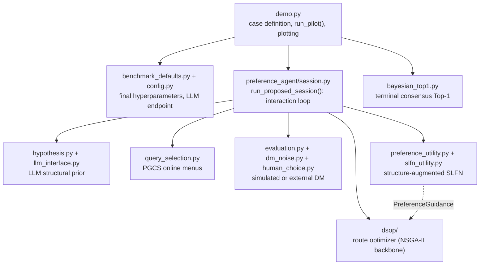
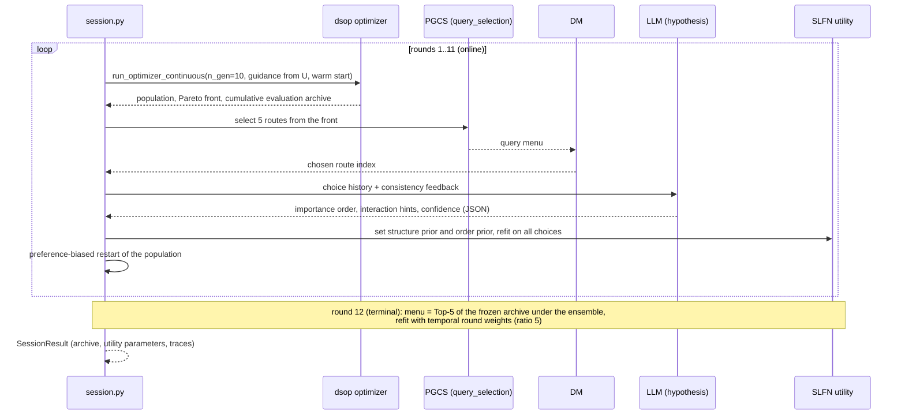

# PILOT: Preference-Aligned Transmission Line Routing via Interactive LLM-Guided Evolutionary Optimization

This repository contains the core implementation of **PILOT** and a runnable
demo on a real transmission-line routing map.

PILOT couples an evolutionary route optimizer with an interactive preference
learner. At each interaction round the decision maker (DM) picks a route from a
small menu; an LLM summarizes the choice history into a structural preference
prior (objective priorities and interactions), and a structure-augmented SLFN
utility model is fitted jointly on the observed choices and this prior. The
learned utility guides the subsequent search, and the final recommendation is a
consensus Top-1 over a five-member SLFN ensemble.

## Quick start

```bash
python -m venv .venv && source .venv/bin/activate
pip install -r requirements.txt          # Python 3.10+

export OPENAI_API_KEY=...                # optional, see "LLM configuration"
python demo.py                           # paper budget, about 1 min
python demo.py --gens-per-round 2        # quick check
```

The demo writes `demo_output/route.png` (recommended route on the terrain map)
and `demo_output/summary.json` (objective values of the recommended route and
its hidden-DM score Psi, lower is better, normalized by the final archive).

## Architecture

### Layers



`demo.py` builds the session configuration from `benchmark_defaults.py`,
calls `preference_agent.run_full_session()`, which runs
`session.run_proposed_session()`, and finally applies
`bayesian_top1.calibrate_session_top1()` to obtain the recommended route.

### One PILOT session

With the paper configuration there are 12 consultations; the optimizer runs
10 generations before the first one and 10 generations between consecutive
ones (120 generations in total).



Steps in more detail (all in `run_proposed_session`):

1. **Search.** `dsop.run_optimizer_continuous` evolves the route population.
   From the second round on, `dsop.PreferenceGuidance.from_utility_model`
   turns the current SLFN into a preference-aware environmental selection,
   and the population is warm-started with a share of utility-ranked routes
   (`_build_biased_warmstart`). Every evaluated route is recorded in a
   finite-run Pareto archive (`dsop/evaluation_archive.py`).
2. **Online PGCS query.** `_select_fixed_round_candidates` →
   `query_selection.select_candidate_indices` picks 5 informative routes
   from the current front using the learned utility.
3. **DM choice.** `evaluation.choose_path` simulates the DM with a hidden
   Tchebycheff utility (optionally with Bradley–Terry choice noise,
   `dm_noise.py`). A real user can be plugged in through the
   `ChoiceProvider` protocol in `human_choice.py`.
4. **LLM structural prior.** `hypothesis._generate_structure_only_estimate_llm`
   formats the menus, choices and relative standings into a prompt and parses
   the JSON answer (at most 3 importance pairs, at most 2 interaction hints,
   one confidence). `session._build_structure_prior_payload` maps it to prior
   targets on the SLFN cross terms. If the LLM is unavailable or the answer is
   invalid, the last valid prior is carried forward (or none is used).
5. **Utility learning.** The SLFN (`preference_utility.BenchmarkSLFNUtilityLearner`,
   which wraps `slfn_utility.FCPEUtilityLearner`) is refitted on all
   pairwise choices with the prior as a confidence-weighted regularizer.
   In parallel a non-controlling five-member ensemble
   (`BenchmarkSLFNEnsembleUtilityLearner`, seeds 42–46) receives the same
   updates; it does not steer the search.
6. **Terminal PGCS and recommendation.** After the last search block, the
   archive is frozen; the ensemble ranks it, its Top-5 forms the final menu,
   the models are refitted with geometric temporal weights (later rounds
   count up to 5× more), and `bayesian_top1.calibrate_session_top1` returns
   the archive route ranked best by the ensemble consensus.

### Module reference

| Module | Responsibility | Key symbols |
|---|---|---|
| `demo.py` | Example case, final configuration, result plotting | `run_pilot`, `FINAL_CONFIG` |
| `benchmark_defaults.py` | Single source of the final PILOT hyperparameters (budget, menu size, guidance ratio, restart ratio, SLFN settings) | `FORMAL_PROPOSED_RUNTIME`, `FORMAL_PROPOSED_SESSION_KWARGS`, `build_proposed_run_full_session_kwargs` |
| `config.py` | LLM backend, key, base URL and model from environment variables | `OPENAI_API_KEY`, `DEFAULT_LLM_MODEL` |
| `preference_agent/main.py` | Public entry point | `run_full_session` |
| `preference_agent/models.py` | Session configuration and result dataclasses | `SessionConfig`, `SessionResult`, `RoundTrace` |
| `preference_agent/session.py` | Interaction loop, prior mapping, warm start, terminal calibration | `run_proposed_session`, `_build_session_utility_learners` |
| `preference_agent/query_selection.py` | Online PGCS menu construction | `select_candidate_indices` |
| `preference_agent/hypothesis.py` | LLM prompt construction and parsing of the structural prior | `_generate_structure_only_estimate_llm` |
| `preference_agent/llm_interface.py`, `llm_trace.py` | OpenAI-compatible client and optional request tracing | `maybe_get_client`, `call_llm_json` |
| `preference_agent/calibration.py` | Behavioral consistency feedback added to the next prompt | `build_consistency_feedback` |
| `preference_agent/evaluation.py`, `dm_noise.py`, `human_choice.py` | Simulated DM (hidden Tchebycheff utility, optional choice noise) and the interface for an external DM | `choose_path`, `ChoiceProvider` |
| `preference_agent/scoring.py` | Objective canonicalization, normalization, Tchebycheff score Psi | `canonicalize_pareto_metrics_batch`, `tchebycheff_score_clipped` |
| `preference_agent/bayesian_top1.py` | Consensus Top-1 over the SLFN ensemble on the final archive | `calibrate_session_top1`, `select_archive_rank_top1` |
| `preference_agent/slfn_shadow_bank.py` | Passive bank of SLFN variants (parameter studies only; inactive in the demo) | `SLFNParameterShadowBank` |
| `preference_utility.py` | Utility-learner factory and SLFN / ensemble wrappers | `build_pairwise_utility_learner`, `BenchmarkSLFNUtilityLearner`, `BenchmarkSLFNEnsembleUtilityLearner` |
| `slfn_utility.py` | Structure-augmented SLFN: features, joint behavioral + prior loss, fitting | `FCPEUtilityLearner`, `FCPEUtilityEnsemble` |
| `dsop/optimizer.py` | Optimizer entry points | `run_optimizer_continuous` |
| `dsop/population.py`, `path_operators.py`, `path_planners.py` | NSGA-II environmental selection, crossover / mutation / local search, A* and RRT initialization | |
| `dsop/path_metrics.py`, `map_cache.py`, `constants.py` | Route encoding and the four objectives on the terrain map | |
| `dsop/preference.py` | Utility-guided selection inside the optimizer | `PreferenceGuidance` |
| `dsop/evaluation_archive.py` | Cumulative non-dominated archive of all evaluated routes | `EvaluationRecorder` |
| `scenario_visualization.py`, `utils.py` | Terrain colormap and route plotting | `draw_paths_on_map_axes` |

See `dsop/README.md` for the optimizer API.

### Paper-to-code map

| Paper component | Code |
|---|---|
| Interactive loop (Algorithm 1) | `preference_agent/session.py::run_proposed_session` |
| LLM structural preference prior | `preference_agent/hypothesis.py`, `session._build_structure_prior_payload` |
| Structure-augmented SLFN and joint loss | `slfn_utility.py::FCPEUtilityLearner`, `preference_utility.py` |
| PGCS, online menus | `session._select_fixed_round_candidates`, `query_selection.py` |
| PGCS, terminal menu and recommendation | `session._archive_shortlist_snapshot` (terminal phase), `bayesian_top1.py` |
| Temporal weighting r_tw | `temporal_weight_ratio` (5.0) in `demo.FINAL_CONFIG` |
| Preference-aware environmental selection and restart | `dsop/preference.py`, `session._build_biased_warmstart` |
| Hidden Tchebycheff DM and score Psi | `evaluation.choose_path`, `scoring.tchebycheff_score_clipped` |

### Conventions

* Objectives are ordered `[Cost, Length, Safety, Smoothness]`
  (`preference_agent/constants.py`). Cost and Length are minimized, Safety and
  Smoothness are maximized.
* Arrays named `*_raw` / `*_raw_all_min` are in the optimizer's internal
  all-minimization space (Safety and Smoothness negated); `*_canon` / canonical
  values are in the user-facing space above.
  `scoring.canonicalize_pareto_metrics_batch` converts between them.
* Map coordinates are `(x, y)` grid cells of the terrain map in `outputs/`.

## LLM configuration

Credentials are read from environment variables only (see `.env.example`):

```bash
export OPENAI_API_KEY=...
export OPENAI_BASE_URL=https://api.openai.com/v1   # optional, any OpenAI-compatible endpoint
export OPENAI_LLM_MODEL=gpt-4o-mini                # optional
```

Without `OPENAI_API_KEY` PILOT still runs, but the SLFN utility is then learned
from the DM choices alone (no LLM structural prior).

## Programmatic use

```python
from demo import run_pilot

result, top1 = run_pilot(start=(7, 234), end=(445, 169),
                         true_weights=[0.2, 0.67, 0.01, 0.12], seed=0,
                         llm_model="gpt-4o-mini", output_dir="my_run")
route = result.final_archive_paths[top1["selected_index"]]
```

`result` is a `preference_agent.models.SessionResult` (archive, per-round
traces, LLM priors, utility parameters); `top1` holds the selected archive
index and its objective values.
